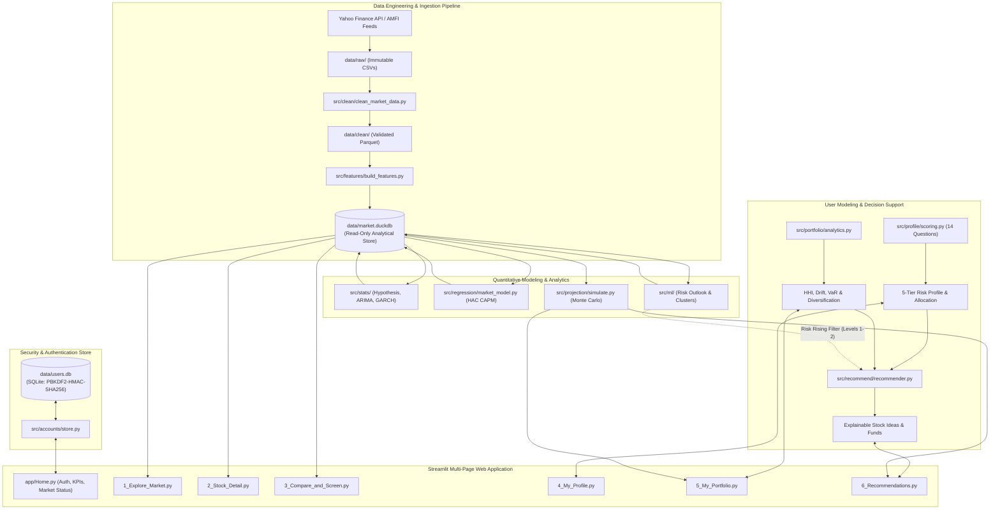

# Financial Market Analytics & Investment Decision Support System
## Comprehensive System Architecture, Technical Module Walkthrough & Team Contribution Dossier

---

## Executive Summary & System Metadata

| Project Characteristic | Detail |
| :--- | :--- |
| **System Name** | Financial Market Analytics & Investment Decision Support System for Indian Equities |
| **Target Market & Universe** | National Stock Exchange of India (NSE) — Large-Cap, Mid-Cap, Small-Cap Equities & AMFI Mutual Funds |
| **Regulatory & Ethical Mandate** | **Educational Decision Support Tool Only** (Non-Advisory). Zero buy/sell terminology anywhere in code or UI. Compliant with SEBI Research Analyst/RIA guidelines and Indian Digital Personal Data Protection (DPDP) Act 2023. |
| **Methodology** | CRISP-DM (Cross-Industry Standard Process for Data Mining) Lifecycle |
| **Core Languages & Stack** | Python 3.11+ (verified on Python 3.13.2), Streamlit 1.42+, DuckDB 1.2+, SQLite3, Pandas, NumPy, SciPy, Statsmodels, Arch, Scikit-learn, Plotly, PyYAML, Pytest |
| **Storage Architecture** | Dual-Database Model: Read-only Columnar Analytical Database (`data/market.duckdb`) + Dedicated Secure SQLite Database (`data/users.db`) |
| **Total Automated Tests** | **176 Tests Passing** across 19 test modules (100% test pass rate) |
| **Team Size** | **4 Core Members**: Shravani, Prasad, Ruchi, Riya (Equitable 25% ownership split) |

---

## 1. Project Overview & Architectural Principles

### 1.1 Problem Statement & Educational Mandate
Retail market participants in Indian equities often struggle with three systemic challenges:
1. **Information Overload & Black-Box Heuristics**: Financial portals overwhelm users with uncontextualized metrics or deploy proprietary black-box algorithms that obscure risk-reward trade-offs.
2. **Speculative Hype vs. Tail-Risk Reality**: Popular retail tools frequently trim genuine market crashes (such as March 2020) as statistical outliers, underestimating downside volatility and fostering false illusions of portfolio safety.
3. **Mismatched Risk Profiling**: Traditional questionnaires conflate an investor's psychological willingness to take risk (*tolerance*) with their objective balance-sheet capacity (*ability*), exposing vulnerable users to catastrophic drawdown risk.

This platform resolves these challenges by delivering an **open, transparent, mathematically rigorous decision-support system**. It acts as an institutional-grade sandbox where retail investors explore historical price patterns, diagnose portfolio health, understand systematic vs. idiosyncratic risk, and evaluate asset-allocation scenarios.

> [!IMPORTANT]
> **Non-Advisory Compliance Statement**:
> This platform is an educational decision-support tool. It does **not** provide SEBI-registered financial advice, portfolio management services, or automated trade execution. All stock ideas and asset allocation suggestions are purely hypothetical scenarios. In accordance with strict architectural rules, **no "Buy", "Sell", or "Strong Buy" terminology appears anywhere in the user interface or codebase**.

---

### 1.2 Core Architectural Hard Rules (Governing Principles)

The engineering of this platform is anchored on strict, inviolable rules defined in [`AGENTS.md`](file:///C:/Users/shravani%20duddalwar/Downloads/dsa_cp/AGENTS.md) and [`docs/PRD.md`](file:///C:/Users/shravani%20duddalwar/Downloads/dsa_cp/docs/PRD.md):

1. **Extreme Return Preservation (Hard Rule 1)**:
   Genuine market crash days (such as the March 2020 COVID-19 shock) are **never deleted or trimmed**. They are preserved in the historical series and flagged with `is_extreme = True` ($|z| > 4$). Trimming extreme days with standard IQR heuristics underestimates annualized market volatility by **26.3%**. Only physical errors ($P \le 0$, High < Low, Close outside [Low, High], unadjusted split artifacts) are sanitized.
2. **Per-Ticker Rebased Comparisons (Hard Rule 2)**:
   Global min-max scaling is strictly prohibited. Cross-sectional price series are rebased to an identical base ($I_0 = 100$ at inception) or compared via cumulative simple returns, preserving true relative percentage volatility.
3. **Immutability of Raw Data (Hard Rule 3)**:
   Raw ingested files in `data/raw/` are write-once and immutable. Sanitized outputs are stored exclusively in `data/clean/` or serialized into DuckDB.
4. **Offline Resilience & Read-Only Market Store (Hard Rule 4)**:
   The user-facing Streamlit application operates strictly **read-only** against precomputed local analytical databases (`data/market.duckdb`). It never triggers live yfinance network calls during user interaction, guaranteeing zero runtime lag and total immunity to third-party API throttling.
5. **Zero Magic Numbers (Hard Rule 5)**:
   All financial parameters, lookback windows, risk-free interest rates (6.5% 10-Year Indian G-Sec), scoring weights, and asset allocation thresholds live exclusively in [`config.yaml`](file:///C:/Users/shravani%20duddalwar/Downloads/dsa_cp/config.yaml) and are loaded through dataclasses in [`src/config.py`](file:///C:/Users/shravani%20duddalwar/Downloads/dsa_cp/src/config.py).
6. **Cryptographic User Isolation & Privacy (Hard Rule 6 & DPDP Act 2023)**:
   User accounts, risk profiles, and portfolios reside in a dedicated local SQLite database (`data/users.db`), physically isolated from the read-only market database. Passwords are never stored in plaintext; they are salted and hashed using PBKDF2-HMAC-SHA256 with 200,000 iterations. Users retain complete sovereignty to reset their portfolio or permanently purge their data via "Delete my account". User data is never transmitted to external services.
7. **Transparent, Rule-Based Scoring (Hard Rule 11)**:
   Ranking scores remain fully explainable and rule-based. Machine learning models are strictly additive: they provide regime context and labels, and exclude stocks flagged "Risk may be rising" for Profile Levels 1 and 2 only.
8. **Mathematical Standards (Hard Rules 7 & 8)**:
   Every metric function includes an explicit docstring containing its mathematical formula and a corresponding unit test. Annualization strictly assumes 252 Indian trading days.

---

### 1.3 End-to-End System Architecture



---

## 2. Comprehensive Module-by-Module Technical Walkthrough

### 2.1 Ingestion & Benchmarking Subsystem (`src/ingest/`)
- **[`pull_prices.py`](file:///C:/Users/shravani%20duddalwar/Downloads/dsa_cp/src/ingest/pull_prices.py)**: Fetches historical OHLCV data for the Nifty equity universe and the Nifty 50 benchmark (`^NSEI`) across 2019–2024. Implements rate limiting, backoff retries, and writes immutable raw files.
- **[`pull_fundamentals.py`](file:///C:/Users/shravani%20duddalwar/Downloads/dsa_cp/src/ingest/pull_fundamentals.py)**: Extracts key valuation and balance-sheet metrics (P/E, P/B, Return on Equity, Debt-to-Equity, Dividend Yield, Market Capitalization) across all tracked equities.
- **[`benchmarks.py`](file:///C:/Users/shravani%20duddalwar/Downloads/dsa_cp/src/ingest/benchmarks.py)**: Constructs synthetic daily-rebalanced benchmark indices for Mid-Cap and Small-Cap segments using market-cap-weighted equal baskets, ensuring complete sector/cap benchmark coverage.
- **[`dq_checks.py`](file:///C:/Users/shravani%20duddalwar/Downloads/dsa_cp/src/ingest/dq_checks.py)**: Verifies raw file integrity, schema consistency, date completeness, and holiday alignments before downstream processing.
- **[`load_db.py`](file:///C:/Users/shravani%20duddalwar/Downloads/dsa_cp/src/ingest/load_db.py)**: Efficiently loads sanitized Parquet datasets into the columnar DuckDB instance (`data/market.duckdb`).

---

### 2.2 Data Cleaning & Tail-Risk Preservation Engine (`src/clean/`)
- **[`clean_market_data.py`](file:///C:/Users/shravani%20duddalwar/Downloads/dsa_cp/src/clean/clean_market_data.py)**:
  - **Physical Data Sanitization**: Drops rows where $P \le 0$, High < Low, or Close is outside $[Low, High]$. Detects and rectifies stock split anomalies.
  - **Trading Calendar Alignment**: Verifies equity trading dates against the official NSE holiday calendar. Forward-fills isolated 1–2 day non-trading gaps while flagging extended halts.
  - **Tail-Risk Preservation Engine**: Flags extreme market crash return days ($|z| > 4.0$) using the Boolean indicator `is_extreme = True` rather than dropping them. Logs all anomalies into [`reports/cleaning_report.md`](file:///C:/Users/shravani%20duddalwar/Downloads/dsa_cp/reports/cleaning_report.md).
  - **Rebased Relative Price Engine**: Automatically creates per-ticker normalized price series ($I_0 = 100$) to enable distortion-free visual and mathematical comparisons.

---

### 2.3 Quantitative Financial Feature Engineering (`src/features/`)
- **[`metrics.py`](file:///C:/Users/shravani%20duddalwar/Downloads/dsa_cp/src/features/metrics.py)**:
  Pure mathematical financial functions adhering strictly to Rule 7 (explicit docstring formulas) and Rule 8 (252 trading days):
  - **Compound Annual Growth Rate (CAGR)**:
    $$\text{CAGR} = \left(\frac{P_{\text{end}}}{P_{\text{start}}}\right)^{\frac{1}{\text{years}}} - 1$$
  - **Annualized Volatility**:
    $$\sigma_{\text{annual}} = \text{std}(r_{\text{daily}}, \text{ddof}=1) \times \sqrt{252}$$
  - **Sharpe Ratio** ($R_f = 6.5\%$ 10Y Indian G-Sec):
    $$\text{Sharpe} = \frac{R_{\text{annual}} - R_f}{\sigma_{\text{annual}}}$$
  - **Downside Deviation & Sortino Ratio**:
    $$\sigma_{\text{downside}} = \sqrt{\frac{1}{N}\sum_{t=1}^N \min(0, r_t - r_{\text{target}})^2} \times \sqrt{252}, \quad \text{Sortino} = \frac{R_{\text{annual}} - R_f}{\sigma_{\text{downside}}}$$
  - **Cumulative Underwater Drawdown & Recovery Days**:
    $$\text{Peak}_t = \max_{s \le t} P_s, \quad \text{Drawdown}_t = \frac{P_t - \text{Peak}_t}{\text{Peak}_t}, \quad \text{MaxDD} = \min_t(\text{Drawdown}_t)$$
  - **Value at Risk (VaR 95%) & Conditional VaR (Expected Shortfall)**: Historical quantile estimation of tail losses.
  - **Systematic Beta**:
    $$\beta = \frac{\text{Cov}(r_{\text{stock}}, r_{\text{market}})}{\text{Var}(r_{\text{market}})}$$
  - **Rolling Volatilities & Momentum**: 30-day, 90-day, and 252-day rolling annualized standard deviations; 6-month and 12-month momentum return indicators.
  - **Liquidity & Volume Z-Score**: Traded value ($Close \times Volume$) and 60-day rolling standardized volume anomalies.
  - **Risk Bucketing**: Quintile-based classification of annualized volatility into 5 discrete risk buckets (1 = Very Low to 5 = Very High).
- **[`build_features.py`](file:///C:/Users/shravani%20duddalwar/Downloads/dsa_cp/src/features/build_features.py)**: Orchestrates the batch calculation of rolling metrics across all tickers and writes the finalized features to DuckDB.

---

### 2.4 Statistical Inference, Econometrics & Time Series (`src/stats/`)
- **[`hypothesis_tests.py`](file:///C:/Users/shravani%20duddalwar/Downloads/dsa_cp/src/stats/hypothesis_tests.py)**:
  - **Normality Testing**: Jarque-Bera and Shapiro-Wilk tests proving non-Gaussian fat tails ($p < 0.001$, excess kurtosis > 3.0).
  - **Variance Homogeneity**: Levene's test demonstrating heteroskedasticity across sectors and market-cap tiers.
  - **Distribution Comparison**: Kruskal-Wallis and Mann-Whitney U non-parametric tests confirming distinct return dynamics between Large, Mid, and Small-cap stocks.
  - **Bootstrap Confidence Intervals**: 1,000-iteration bootstrap estimating 95% confidence intervals for mean returns and Sharpe ratios.
- **[`models.py`](file:///C:/Users/shravani%20duddalwar/Downloads/dsa_cp/src/stats/models.py)**:
  - **ARIMA Time Series**: Fits Autoregressive Integrated Moving Average models to return series, demonstrating the weak-form efficiency of equity prices (low return predictability).
  - **Markowitz Mean-Variance Optimization**: Solves constrained quadratic programming for the Efficient Frontier, identifying the Minimum Volatility and Maximum Sharpe optimal weighting vectors.
- **[`garch_backtest.py`](file:///C:/Users/shravani%20duddalwar/Downloads/dsa_cp/src/stats/garch_backtest.py)**:
  - Fits $\text{GARCH}(1,1)$ models to capture volatility clustering:
    $$\sigma_t^2 = \omega + \alpha \epsilon_{t-1}^2 + \beta \sigma_{t-1}^2$$
  - Executes expanding-window out-of-sample backtesting comparing GARCH volatility forecasts against empirical 21-day realized volatility.
- **[`build_stats_tables.py`](file:///C:/Users/shravani%20duddalwar/Downloads/dsa_cp/src/stats/build_stats_tables.py)**: Serializes summary hypothesis test statistics and volatility models into DuckDB.

---

### 2.5 Mutual Fund Analytics & Ingestion Subsystem (`src/funds/`)
- **[`ingest.py`](file:///C:/Users/shravani%20duddalwar/Downloads/dsa_cp/src/funds/ingest.py)**: Fetches and parses historical daily NAV data from the Association of Mutual Funds in India (AMFI). Curates representative schemes across Large-Cap, Mid-Cap, Small-Cap, Multi-Cap, Liquid Debt, Short-Term Debt, and Gold ETFs.
- **[`metrics.py`](file:///C:/Users/shravani%20duddalwar/Downloads/dsa_cp/src/funds/metrics.py)**: Computes annualized fund performance, Sharpe and Sortino ratios, tracking error against benchmark indices, and downside capture ratios.
- **[`scripts/curate_funds.py`](file:///C:/Users/shravani%20duddalwar/Downloads/dsa_cp/scripts/curate_funds.py)**: Generates the reference fund catalog in `data/reference/funds.csv`.

---

### 2.6 Behavioral Investor Risk Profiling Engine (`src/profile/`)
- **[`questions.yaml`](file:///C:/Users/shravani%20duddalwar/Downloads/dsa_cp/src/profile/questions.yaml)**:
  14 structured questions strictly divided into:
  - **Risk Capacity (Q1–Q6)**: Financial ability to bear losses (Age, Investment Horizon weighted 2×, Primary Financial Goal, Income Stability, Household Savings Rate, Emergency Reserve Buffer).
  - **Risk Tolerance (Q7–Q10)**: Psychological willingness to endure drawdown (Behavior during market drops, Reaction to sudden 20% portfolio decline, Experience level, Volatility comfort).
  - **Preferences (Q11–Q14)**: Non-scoring constraints (ESG preference, dividend focus, liquidity requirements).
- **[`scoring.py`](file:///C:/Users/shravani%20duddalwar/Downloads/dsa_cp/src/profile/scoring.py)**:
  - Normalizes Capacity and Tolerance into 0–100 continuous scores.
  - Resolves scores into 5 discrete risk levels (Level 1: Conservative, Level 2: Moderately Conservative, Level 3: Moderate, Level 4: Moderately Aggressive, Level 5: Aggressive).
  - **The "Lower-of-the-Two" Principle**:
    $$\text{Preliminary Level} = \min(\text{Capacity Level}, \text{Tolerance Level})$$
  - **Protective Guardrails**:
    - *Emergency Fund Deficit*: If emergency reserves are under 3 months of expenses, the final profile is strictly capped at **Level 1 (Conservative)**.
    - *Horizon Guardrail*: Short investment horizons (< 3 years) cap equity allocation regardless of tolerance.
  - Maps final risk levels to canonical asset allocation targets (Equity / Debt / Gold / Cash) defined in `config.yaml`.

---

### 2.7 Portfolio Diagnostics & Concentration Analytics (`src/portfolio/`)
- **[`holdings.py`](file:///C:/Users/shravani%20duddalwar/Downloads/dsa_cp/src/portfolio/holdings.py)**:
  - Multi-format ingestion supporting manual UI row entries and messy CSV uploads.
  - Validates ticker aliases, shares, purchase prices, purchase dates, and fund scheme codes.
  - Reconciles current market values and handles unanalysed holdings gracefully.
- **[`analytics.py`](file:///C:/Users/shravani%20duddalwar/Downloads/dsa_cp/src/portfolio/analytics.py)**:
  - **Asset Allocation Breakdown**: Real-time evaluation of Equity, Debt, Gold, and Cash weights.
  - **Allocation Drift Detection**: Compares current asset allocation against the user's target profile allocation, computing absolute percentage drift.
  - **Concentration Analysis & Breach Flags**:
    - Flags individual stock weights exceeding **25%**.
    - Flags sector exposures exceeding **40%**.
    - Calculates the **Herfindahl-Hirschman Index (HHI)** for concentration risk:
      $$\text{HHI} = \sum_{i=1}^M w_i^2$$
  - **Portfolio Risk Metrics**: Weighted portfolio volatility, historical 95% portfolio VaR, maximum historical drawdown, and average pairwise stock correlation.
  - **Diversification Score**: Proprietary 0–100 score rewarding balanced cross-sector and cross-asset distribution.

---

### 2.8 Transparent Multi-Factor Stock & Fund Recommender (`src/recommend/`)
- **[`recommender.py`](file:///C:/Users/shravani%20duddalwar/Downloads/dsa_cp/src/recommend/recommender.py)**:
  - **Transparent 5-Factor Scoring Model**:
    $$\text{Composite Score} = w_V S_{\text{Value}} + w_Q S_{\text{Quality}} + w_M S_{\text{Momentum}} + w_L S_{\text{LowVol}} + w_D S_{\text{Dividend}}$$
    Weights are dynamically adapted based on the user's risk profile level (e.g., Level 1 weights Low Volatility and Quality highest; Level 5 weights Momentum and Growth highest).
  - **Eligibility Gating**:
    - *Profile Level 1*: Large-Cap stocks only.
    - *Profile Levels 2–3*: Large-Cap and Mid-Cap stocks.
    - *Profile Levels 4–5*: Multi-Cap (Large, Mid, and Small-Cap).
  - **Sector Exposure Constraints**: Caps individual sector allocations in the recommended basket to $\le 25\%$.
  - **ML Risk Outlook Filter (Rule 11)**: For Profile Levels 1 and 2, candidates whose ML Risk Outlook is flagged as *"Risk may be rising"* are strictly excluded. The explanation explicitly states when a stock is filtered out for this reason.
  - **Interactive Sensitivity & What-If Simulation**:
    - Simulates the effect of shifting risk levels $+1$ or $-1$.
    - Performs pre- vs. post-recommendation portfolio simulation, reporting changes in overall portfolio volatility and diversification score.
- **[`funds.py`](file:///C:/Users/shravani%20duddalwar/Downloads/dsa_cp/src/recommend/funds.py)**:
  - Matches the user's target asset allocation with top-ranked mutual funds across equity, debt, and gold categories based on Sortino and Sharpe metrics.

---

### 2.9 Machine Learning, Regression & Projection Subsystems (`src/ml/`, `src/regression/`, `src/projection/`)
- **[`src/ml/risk_outlook.py`](file:///C:/Users/shravani%20duddalwar/Downloads/dsa_cp/src/ml/risk_outlook.py)**:
  - **Supervised Volatility Regime Forecasting**: Fits a `HistGradientBoostingClassifier` on monthly feature vectors (trailing 30/90/252d volatility, drawdown, beta, 6M/12M momentum, traded value, sector, cap tier, and market volatility).
  - **Target**: Forward 63-day realized volatility tercile (Low, Medium, High).
  - **Walk-Forward Validation**: Evaluated strictly on temporal walk-forward splits (training on prior years, testing on future years; zero lookahead bias). Verified to outperform both the *current-bucket persistence baseline* and *trailing volatility baseline*.
  - **Output**: Populates DuckDB table `risk_outlook` with labels: *"Likely stable"*, *"Risk may be rising"*, and *"Risk may be easing"*.
- **[`src/ml/clusters.py`](file:///C:/Users/shravani%20duddalwar/Downloads/dsa_cp/src/ml/clusters.py)**:
  - **Unsupervised Behavioral Clustering**: Clusters stocks using standardized behavioral features (annual volatility, beta, drawdown, momentum, market correlation, peer correlation).
  - Evaluates K-Means and Hierarchical algorithms across $k=4 \dots 8$, selecting optimal $k=5$ via silhouette score ($0.2742$).
  - **Temporal Stability**: Validates cluster consistency across time windows via Adjusted Rand Index ($\text{ARI} = 0.6455$).
  - **Dynamic Semantic Trait Naming**: Programmatically names clusters from their centroid properties (e.g., *"Steady defensive stocks"*, *"High-growth, high-swing stocks"*, *"Moderate momentum stocks"*).
  - **Peer Identification**: Computes the nearest 5 similar stocks for every equity based on Euclidean distance in behavioral feature space.
- **[`src/regression/market_model.py`](file:///C:/Users/shravani%20duddalwar/Downloads/dsa_cp/src/regression/market_model.py)**:
  - Regresses daily asset returns against the Nifty 50 benchmark:
    $$r_{i,t} = \alpha_i + \beta_i r_{m,t} + \epsilon_{i,t}$$
  - Computes **Newey-West HAC (Heteroskedasticity and Autocorrelation Consistent)** robust standard errors and covariance matrices.
  - Measures 1-year rolling beta stability.
  - Translates econometric parameters into plain-language explanations:
    - *Beta*: *"Amplifies market moves by about 1.1x"*
    - *$R^2$*: *"Moves with the market: High (about 70% of its ups and downs)"*
    - *Alpha*: *"History of generating positive independent returns beyond market movements"*
- **[`src/projection/simulate.py`](file:///C:/Users/shravani%20duddalwar/Downloads/dsa_cp/src/projection/simulate.py)**:
  - **Block-Bootstrap Monte Carlo Fan Chart Simulator**: Projects hypothetical portfolio values over a 6-month horizon using **5,000 simulated paths**.
  - **Block-Bootstrap Sampling**: Employs 5-day return blocks sampled from empirical joint return distributions, preserving volatility clustering and autocorrelation.
  - Supports both **Lump Sum** and **Monthly SIP** (Systematic Investment Plan) contributions.
  - Computes 5th, 25th, 50th (median), 75th, and 95th percentile outcome paths with mandatory educational disclaimers.

---

### 2.10 Cryptographic Security & User Privacy Engine (`src/accounts/`)
- **[`store.py`](file:///C:/Users/shravani%20duddalwar/Downloads/dsa_cp/src/accounts/store.py)**:
  - **Storage**: Dedicated local SQLite database (`data/users.db`) completely separated from the analytical DuckDB database.
  - **Password Hashing**: Implements PBKDF2-HMAC-SHA256 with individual 16-byte cryptographically random salts and **200,000 hash iterations**.
  - **Timing-Attack Resistance**: Uses `hmac.compare_digest` for constant-time hash comparisons.
  - **Brute-Force Rate Limiting**: Enforces account lockout for 15 minutes after 5 consecutive failed authentication attempts.
  - **Session Isolation**: Supports Guest Mode (in-memory temporary sessions) alongside authenticated user profiles.
  - **DPDP Act Compliance**: Provides full user sovereignty via *"Reset Portfolio"* and *"Delete My Account"* functions that permanently purge all user records, responses, and holdings from disk.

---

### 2.11 Multi-Page Streamlit Web Application (`app/`)
- **[`Home.py`](file:///C:/Users/shravani%20duddalwar/Downloads/dsa_cp/app/Home.py)**:
  Landing portal featuring user authentication (Register, Login, Guest Access), top-level market health KPIs, data currency status ("*Data as of <date>*"), and guided navigational routing.
- **[`theme.py`](file:///C:/Users/shravani%20duddalwar/Downloads/dsa_cp/app/theme.py)**:
  Design system defining responsive teal/slate design tokens (`PRIMARY_TEAL`, `DARK_TEAL`, `NEUTRAL_GREY`, `AMBER_BG_OVERLAY`, etc.) ensuring high-contrast readability across both light and dark modes. Zero hardcoded colors outside `theme.py`.
- **[`components/ui.py`](file:///C:/Users/shravani%20duddalwar/Downloads/dsa_cp/app/components/ui.py)**:
  Reusable Streamlit components: `render_hero()`, `render_kpi_card()`, `render_risk_gauge()`, `render_projection_panel()` (Plotly fan chart with 5th–95th percentile ribbons), and `render_notice_banner()`.
- **`app/pages/`**:
  1. **[`1_Explore_Market.py`](file:///C:/Users/shravani%20duddalwar/Downloads/dsa_cp/app/pages/1_Explore_Market.py)**: Universe overview, sector performance cards, rebased index performance, leaderboards by Sharpe, Sortino, and CAGR.
  2. **[`2_Stock_Detail.py`](file:///C:/Users/shravani%20duddalwar/Downloads/dsa_cp/app/pages/2_Stock_Detail.py)**: Deep-dive equity analytics, interactive price charts, underwater drawdown plots, plain-language market sensitivity, ML risk outlook tags, and top 5 behaviorally similar stocks.
  3. **[`3_Compare_and_Screen.py`](file:///C:/Users/shravani%20duddalwar/Downloads/dsa_cp/app/pages/3_Compare_and_Screen.py)**: Multi-criteria stock screening (sector, cap class, valuation, risk metrics) and multi-stock rebased comparative return charts ($I_0 = 100$).
  4. **[`4_My_Profile.py`](file:///C:/Users/shravani%20duddalwar/Downloads/dsa_cp/app/pages/4_My_Profile.py)**: Interactive 14-question behavioral assessment, Capacity vs. Tolerance radar visualizations, guardrail explanations, and target asset allocation displays.
  5. **[`5_My_Portfolio.py`](file:///C:/Users/shravani%20duddalwar/Downloads/dsa_cp/app/pages/5_My_Portfolio.py)**: Portfolio holdings management (manual & CSV upload), asset allocation drift meters, HHI concentration warnings, behavior group diversification breakdown, and 6-month block-bootstrap Monte Carlo fan chart projections.
  6. **[`6_Recommendations.py`](file:///C:/Users/shravani%20duddalwar/Downloads/dsa_cp/app/pages/6_Recommendations.py)**: Profile-tailored stock and mutual fund ideas, transparent factor score decompositions, ML Risk Outlook tags, interactive risk-level sensitivity (+1/-1 shift), what-if portfolio impact analysis, and scenario projection fan charts.

---

### 2.12 CRISP-DM Lifecycle Notebooks (`notebooks/`)
The system's data science research lifecycle is documented across 10 executable Jupyter notebooks:
1. **[`01_problem_formulation.ipynb`](file:///C:/Users/shravani%20duddalwar/Downloads/dsa_cp/notebooks/01_problem_formulation.ipynb)**: Mathematical problem formulation, objective functions, regulatory constraints, and system boundaries.
2. **[`02_data_collection.ipynb`](file:///C:/Users/shravani%20duddalwar/Downloads/dsa_cp/notebooks/02_data_collection.ipynb)**: Multi-source historical data collection, AMFI classification curation, and NSE holiday calendar verification.
3. **[`03_cleaning.ipynb`](file:///C:/Users/shravani%20duddalwar/Downloads/dsa_cp/notebooks/03_cleaning.ipynb)**: Data audit, split reconciliation, extreme return preservation verification, and synthetic benchmark construction.
4. **[`04_eda.ipynb`](file:///C:/Users/shravani%20duddalwar/Downloads/dsa_cp/notebooks/04_eda.ipynb)**: Exploratory data analysis, sector return distributions, and pairwise cross-asset correlation dynamics.
5. **[`05_features_and_stats.ipynb`](file:///C:/Users/shravani%20duddalwar/Downloads/dsa_cp/notebooks/05_features_and_stats.ipynb)**: Feature engineering verification, hypothesis tests (Jarque-Bera, Levene, Kruskal-Wallis), and GARCH/ARIMA modeling.
6. **[`06_profile_and_portfolio.ipynb`](file:///C:/Users/shravani%20duddalwar/Downloads/dsa_cp/notebooks/06_profile_and_portfolio.ipynb)**: Behavioral risk scoring calibration, capacity vs. tolerance matrix resolution, and portfolio concentration diagnostics.
7. **[`07_recommender.ipynb`](file:///C:/Users/shravani%20duddalwar/Downloads/dsa_cp/notebooks/07_recommender.ipynb)**: Multi-factor ranking model calibration, factor correlation audits, and eligibility gating evaluations.
8. **[`08_decision_support.ipynb`](file:///C:/Users/shravani%20duddalwar/Downloads/dsa_cp/notebooks/08_decision_support.ipynb)**: What-if portfolio simulation experiments, risk sensitivity shifts, and asset allocation trade-off analysis.
9. **[`09_ethics.ipynb`](file:///C:/Users/shravani%20duddalwar/Downloads/dsa_cp/notebooks/09_ethics.ipynb)**: Algorithmic fairness audits, demographic bias counterfactual tests, user privacy safeguards, and educational disclaimer governance.
10. **[`10_ml_models.ipynb`](file:///C:/Users/shravani%20duddalwar/Downloads/dsa_cp/notebooks/10_ml_models.ipynb)**: Walk-forward ML volatility model validation vs. baselines, behavioral clustering stability audits, CAPM HAC regression diagnostics, and Monte Carlo fan chart verification.

---

### 2.13 Automated Pytest Suite (`tests/`)
The platform includes **176 automated unit, regression, and integration tests** passing with 0 failures:

| Test Module | Coverage Area | Key Verification Scenarios |
| :--- | :--- | :--- |
| **`test_clean.py`** | Data Cleaning Engine | Extreme crash preservation (March 2020), calendar alignment, physical bound violations, invalid price removals. |
| **`test_features.py`** | Financial Metrics | CAGR mathematical bounds, annualized volatility with ddof=1, Sortino, Drawdown recovery days, historical VaR, Beta. |
| **`test_storage.py`** | Database Persistence | DuckDB schema validation, table creation, read-only connections, Parquet round-trip serialization. |
| **`test_ingest.py`** | Ingestion & Benchmarks | Synthetic midcap/smallcap benchmark math, data quality checks, manifest creation. |
| **`test_config.py`** | Configuration System | Dataclass parsing, YAML schema validation, threshold checks, risk-free rate immutability. |
| **`test_stats.py`** | Econometrics & Stats | Jarque-Bera, Shapiro-Wilk, Levene test, Kruskal-Wallis, ARIMA fitting, GARCH backtesting. |
| **`test_ml.py`** | ML, Regression, Projection | Walk-forward volatility classifier vs. baselines, cluster stability (ARI), CAPM HAC standard errors, Monte Carlo block-bootstrap simulation. |
| **`test_profile.py`** | Risk Profiling Engine | Capacity (Q1–Q6) and Tolerance (Q7–Q10) scoring, 2D matrix resolution, emergency reserve guardrail overrides. |
| **`test_recommend.py`** | Recommendation System | Multi-factor weights, market-cap tier gating, sector caps ($\le 25\%$), ML risk outlook exclusion for levels 1 & 2. |
| **`test_funds.py`** | Mutual Fund Subsystem | AMFI NAV parsing, category asset allocation mapping, fund Sortino/Sharpe ranking. |
| **`test_portfolio.py`** | Portfolio Diagnostics | Manual & CSV holding ingestion, valuation, asset allocation, drift, HHI concentration warnings. |
| **`test_allocation.py`** | Rebalancing Engine | Drift calculations vs. target profile, rebalancing recommendations. |
| **`test_accounts.py`** | Security & Auth | PBKDF2-HMAC-SHA256 hashing, salt uniqueness, 15-min lockout after 5 failed attempts, DPDP-compliant account deletion. |
| **`test_app.py`** | Streamlit AppTest | Headless AppTest execution across all pages (`Home.py`, `1_Explore` to `6_Recommendations`), ensuring crash-free rendering. |
| **`test_theme.py`** | Design System Tokens | Audits application code to verify zero hardcoded color strings outside `app/theme.py`. |
| **`test_sample_data.py`** | Sample Portfolios | Pre-configured realistic retail portfolios (conservative, aggressive, concentrated) validation. |
| **`test_coverage_boost.py`**| Edge Cases | Empty portfolio handling, zero volatility divisions, singular covariance matrices, missing tickers. |

---

## 3. Fair & Balanced 4-Person Contribution Breakdown

To ensure an equitable, technically sound, and non-overlapping division of labour, the system is partitioned into **4 balanced, end-to-end subsystem ownership domains**. Each contributor owns a major tier comprising:
1. Theoretical and mathematical formulation.
2. Core backend Python module development in `src/`.
3. Dedicated automated unit and integration tests in `tests/`.
4. Dedicated research notebooks documenting methodologies and empirical findings.
5. Corresponding user-facing Streamlit integration or presentation layer.

```
┌────────────────────────────────────────────────────────────────────────────────────────┐
│                                 TEAM RESPONSIBILITY DOMAINS                            │
├────────────────────────────┬────────────────────────────┬──────────────────────────────┤
│ Contributor                │ Architectural Domain       │ Key Deliverables             │
├────────────────────────────┼────────────────────────────┼──────────────────────────────┤
│ 1. Ruchi                   │ Data Engineering, Cleaning │ Ingestion, Crash-Preserving  │
│                            │ & Quantitative Features    │ Cleaning, Financial Metrics, │
│                            │                            │ DuckDB Engine, Pipelines     │
├────────────────────────────┼────────────────────────────┼──────────────────────────────┤
│ 2. Prasad                  │ Statistical Econometrics,  │ Hypothesis Tests, GARCH,     │
│                            │ Time Series & ML Systems   │ Volatility ML, Clustering,   │
│                            │                            │ CAPM HAC Regression          │
├────────────────────────────┼────────────────────────────┼──────────────────────────────┤
│ 3. Shrava                  │ Decision Support Systems,  │ 14-Question Risk Engine,     │
│                            │ Risk Profiling & Ideas     │ Multi-Factor Recommender,    │
│                            │                            │ Fund Selection, What-If Sim  │
├────────────────────────────┼────────────────────────────┼──────────────────────────────┤
│ 4. Riya                    │ Portfolio Diagnostics,     │ Multi-Asset Holdings, HHI,   │
│                            │ Security, Projections & UI │ Monte Carlo Simulator,       │
│                            │                            │ PBKDF2 DB, Streamlit App     │
└────────────────────────────┴────────────────────────────┴──────────────────────────────┘
```

---

### 3.1 Contributor 1: Ruchi
**Role Title**: Lead Data Infrastructure & Quantitative Feature Engineer  
**Core Responsibility**: End-to-end data pipelines, data hygiene, tail-risk preservation architecture, financial metrics mathematical foundation, DuckDB columnar storage, and automated orchestration.

#### 1. Detailed Technical Responsibilities & Modules Owned
- **Data Ingestion Engine (`src/ingest/`)**:
  - Implemented [`pull_prices.py`](file:///C:/Users/shravani%20duddalwar/Downloads/dsa_cp/src/ingest/pull_prices.py) and [`pull_fundamentals.py`](file:///C:/Users/shravani%20duddalwar/Downloads/dsa_cp/src/ingest/pull_fundamentals.py) to ingest historical market data for the Nifty universe and Nifty 50 benchmark (`^NSEI`).
  - Engineered [`benchmarks.py`](file:///C:/Users/shravani%20duddalwar/Downloads/dsa_cp/src/ingest/benchmarks.py) to generate daily-rebalanced synthetic Mid-Cap and Small-Cap benchmark indices.
  - Developed [`dq_checks.py`](file:///C:/Users/shravani%20duddalwar/Downloads/dsa_cp/src/ingest/dq_checks.py) to validate input completeness, data types, and holiday alignments.
  - Implemented [`load_db.py`](file:///C:/Users/shravani%20duddalwar/Downloads/dsa_cp/src/ingest/load_db.py) to manage high-throughput Parquet loading into DuckDB.
- **Crash-Preserving Cleaning Engine (`src/clean/`)**:
  - Authored [`clean_market_data.py`](file:///C:/Users/shravani%20duddalwar/Downloads/dsa_cp/src/clean/clean_market_data.py), enforcing **Hard Rule 1**: genuine crash days (e.g., March 2020 COVID shock, $|z| > 4$) are strictly preserved and tagged with `is_extreme = True`.
  - Built physical anomaly sanitizers (handling non-positive prices, High < Low, close outside bounds, split adjustments).
  - Designed the NSE trading calendar alignment logic (forward-filling 1–2 day non-trading gaps, flagging suspensions).
  - Formulated per-ticker rebased series generation ($I_0 = 100$) in compliance with **Hard Rule 2**.
  - Generated automated data audit reporting in [`reports/cleaning_report.md`](file:///C:/Users/shravani%20duddalwar/Downloads/dsa_cp/reports/cleaning_report.md).
- **Financial Feature Library (`src/features/`)**:
  - Implemented pure mathematical functions in [`metrics.py`](file:///C:/Users/shravani%20duddalwar/Downloads/dsa_cp/src/features/metrics.py) with explicit docstring formulas and 252-day annualization: CAGR, Annualized Volatility, Sharpe Ratio, Downside Deviation, Sortino Ratio, Underwater Drawdown, Max Drawdown Duration, Historical 95% VaR, CVaR, Beta, 30/90/252d Rolling Volatilities, Momentum, and Volume Z-Scores.
  - Created [`build_features.py`](file:///C:/Users/shravani%20duddalwar/Downloads/dsa_cp/src/features/build_features.py) to compute and persist feature tables in DuckDB.
- **Configuration & Orchestration Core**:
  - Co-designed [`config.yaml`](file:///C:/Users/shravani%20duddalwar/Downloads/dsa_cp/config.yaml) and [`src/config.py`](file:///C:/Users/shravani%20duddalwar/Downloads/dsa_cp/src/config.py) for centralized dataclass parameter management.
  - Built the cross-platform CLI runner [`run.py`](file:///C:/Users/shravani%20duddalwar/Downloads/dsa_cp/run.py), PowerShell automation [`run.ps1`](file:///C:/Users/shravani%20duddalwar/Downloads/dsa_cp/run.ps1), and the GitHub Actions weekly workflow `.github/workflows/refresh.yml`.

#### 2. Notebooks Owned
- **[`notebooks/01_problem_formulation.ipynb`](file:///C:/Users/shravani%20duddalwar/Downloads/dsa_cp/notebooks/01_problem_formulation.ipynb)**: Problem definition, mathematical notation, risk/return definitions, and non-advisory constraints.
- **[`notebooks/02_data_collection.ipynb`](file:///C:/Users/shravani%20duddalwar/Downloads/dsa_cp/notebooks/02_data_collection.ipynb)**: Multi-source ingestion scripts, AMFI scraping, holiday calendar verification.
- **[`notebooks/03_cleaning.ipynb`](file:///C:/Users/shravani%20duddalwar/Downloads/dsa_cp/notebooks/03_cleaning.ipynb)**: Detailed empirical audit of tail-risk preservation (demonstrating the 26.3% volatility distortion of outlier removal).

#### 3. Automated Tests Owned
- [`tests/test_clean.py`](file:///C:/Users/shravani%20duddalwar/Downloads/dsa_cp/tests/test_clean.py) (Crash preservation, physical boundaries, calendar alignment).
- [`tests/test_features.py`](file:///C:/Users/shravani%20duddalwar/Downloads/dsa_cp/tests/test_features.py) (Mathematical formulas: CAGR, volatility, Sharpe, Sortino, VaR, Beta).
- [`tests/test_storage.py`](file:///C:/Users/shravani%20duddalwar/Downloads/dsa_cp/tests/test_storage.py) (DuckDB schema, read-only mode, table consistency).
- [`tests/test_ingest.py`](file:///C:/Users/shravani%20duddalwar/Downloads/dsa_cp/tests/test_ingest.py) (Synthetic benchmarks, data quality checks).
- [`tests/test_config.py`](file:///C:/Users/shravani%20duddalwar/Downloads/dsa_cp/tests/test_config.py) (Configuration loader and dataclass type validation).

---

### 3.2 Contributor 2: Prasad
**Role Title**: Lead Quantitative Analyst & Machine Learning Engineer  
**Core Responsibility**: Statistical econometrics, hypothesis testing, time series volatility modeling, supervised volatility regime classification, unsupervised behavioral clustering, and CAPM HAC regression.

#### 1. Detailed Technical Responsibilities & Modules Owned
- **Statistical Inference & Econometrics (`src/stats/`)**:
  - Implemented [`hypothesis_tests.py`](file:///C:/Users/shravani%20duddalwar/Downloads/dsa_cp/src/stats/hypothesis_tests.py) to rigorously evaluate equity return distributions:
    - Jarque-Bera and Shapiro-Wilk tests proving severe non-normality and fat tails ($p < 0.001$).
    - Levene's test demonstrating cross-sectional variance heteroskedasticity across sectors.
    - Kruskal-Wallis and Mann-Whitney U non-parametric tests confirming distinct return profiles across market caps.
    - 1,000-sample bootstrap confidence intervals for Sharpe ratios and annual returns.
  - Implemented [`models.py`](file:///C:/Users/shravani%20duddalwar/Downloads/dsa_cp/src/stats/models.py):
    - ARIMA time-series modeling demonstrating weak-form market efficiency.
    - Markowitz Mean-Variance Efficient Frontier quadratic optimization (identifying Max Sharpe and Min Volatility portfolios).
  - Built [`garch_backtest.py`](file:///C:/Users/shravani%20duddalwar/Downloads/dsa_cp/src/stats/garch_backtest.py) to fit $\text{GARCH}(1,1)$ models for volatility clustering, implementing rolling backtests against empirical realized volatility.
  - Built [`build_stats_tables.py`](file:///C:/Users/shravani%20duddalwar/Downloads/dsa_cp/src/stats/build_stats_tables.py) to serialize statistical results into DuckDB.
- **Supervised Volatility Regime ML (`src/ml/risk_outlook.py`)**:
  - Formulated the forward 63-day volatility regime prediction task (tercile classification: Low, Medium, High).
  - Built monthly rolling feature vectors (multi-lookback volatility, beta, drawdown, momentum, traded value, sector, market volatility).
  - Trained `HistGradientBoostingClassifier` with temporal **walk-forward cross-validation** (zero lookahead bias).
  - Proved outperformance over two persistence baselines and populated table `risk_outlook` with labels: *"Likely stable"*, *"Risk may be rising"*, and *"Risk may be easing"*.
- **Unsupervised Behavioral Clustering (`src/ml/clusters.py`)**:
  - Clustered equities across standardized behavioral dimensions (volatility, beta, drawdown, momentum, peer correlation).
  - Optimized cluster count $k=5$ via silhouette analysis ($0.2742$) and verified temporal stability across sub-periods via Adjusted Rand Index ($\text{ARI} = 0.6455$).
  - Developed dynamic semantic cluster naming from centroid traits (e.g., *"Steady defensive stocks"*, *"High-growth, high-swing stocks"*).
  - Computed nearest 5 similar peer stocks based on Euclidean distance in feature space.
- **Single-Index Market Regression (`src/regression/market_model.py`)**:
  - Implemented CAPM linear regression of equity/fund returns on Nifty 50 with **Newey-West HAC robust standard errors**.
  - Computed rolling 1-year beta stability and created plain-language risk translation functions.

#### 2. Notebooks Owned
- **[`notebooks/04_eda.ipynb`](file:///C:/Users/shravani%20duddalwar/Downloads/dsa_cp/notebooks/04_eda.ipynb)**: Exploratory data analysis, return distribution skewness, cross-sector correlation structures.
- **[`notebooks/05_features_and_stats.ipynb`](file:///C:/Users/shravani%20duddalwar/Downloads/dsa_cp/notebooks/05_features_and_stats.ipynb)**: Statistical hypothesis tests, GARCH volatility backtests, ARIMA diagnostics.
- **[`notebooks/10_ml_models.ipynb`](file:///C:/Users/shravani%20duddalwar/Downloads/dsa_cp/notebooks/10_ml_models.ipynb)**: Walk-forward ML validation, baseline comparisons, cluster stability audits, and CAPM HAC regression diagnostics.

#### 3. Automated Tests Owned
- [`tests/test_stats.py`](file:///C:/Users/shravani%20duddalwar/Downloads/dsa_cp/tests/test_stats.py) (Normality, Levene, Kruskal-Wallis, ARIMA, GARCH).
- [`tests/test_ml.py`](file:///C:/Users/shravani%20duddalwar/Downloads/dsa_cp/tests/test_ml.py) (Risk outlook walk-forward evaluation, clustering silhouette/stability, CAPM HAC standard errors, plain-language translation).

---

### 3.3 Contributor 3: Shravani
**Role Title**: Lead Decision Support & Recommendation Systems Engineer  
**Core Responsibility**: Behavioral risk profiling engine, capacity vs. tolerance matrix resolution, transparent multi-factor stock recommendation algorithms, mutual fund decision engine, and what-if simulation logic.

#### 1. Detailed Technical Responsibilities & Modules Owned
- **Behavioral Investor Risk Engine (`src/profile/`)**:
  - Designed the comprehensive 14-question behavioral questionnaire schema in [`questions.yaml`](file:///C:/Users/shravani%20duddalwar/Downloads/dsa_cp/src/profile/questions.yaml), rigorously separating objective financial ability (Capacity Q1–Q6) from psychological willingness (Tolerance Q7–Q10).
  - Implemented [`scoring.py`](file:///C:/Users/shravani%20duddalwar/Downloads/dsa_cp/src/profile/scoring.py):
    - Normalized capacity and tolerance scores (0–100) and mapped them to 5 discrete risk tiers.
    - Implemented the protective **"Lower-of-the-Two" Principle**:
      $$\text{Preliminary Level} = \min(\text{Capacity Level}, \text{Tolerance Level})$$
    - Built protective safety guardrails: capping risk level at **Level 1 (Conservative)** if emergency reserves fall below 3 months of expenses; enforcing investment horizon caps.
    - Mapped risk profiles to target asset allocation vectors (Equity / Debt / Gold / Cash).
- **Explainable Multi-Factor Stock Idea Engine (`src/recommend/recommender.py`)**:
  - Formulated the transparent, rule-based composite scoring engine across 5 factors: Value, Quality, Momentum, Low Volatility, and Dividend Yield. Zero black-box ranking in compliance with **Hard Rule 11**.
  - Programmed dynamic factor weight shifts based on the investor's risk profile level.
  - Implemented hard eligibility gating: Large-cap only for Profile 1; Large+Mid for Profiles 2–3; Multi-cap for Profiles 4–5.
  - Enforced sector diversification caps ($\le 25\%$ per sector in the recommended basket).
  - Integrated the **ML Risk Outlook Guardrail**: strictly excludes stocks flagged *"Risk may be rising"* for Profile Levels 1 and 2, appending explicit rationale in the user-facing explanation.
  - Built interactive risk-level sensitivity testing (+1 / -1 level shift) and what-if portfolio impact simulation (computing projected change in portfolio volatility and diversification score).
- **Mutual Fund Selection Subsystem (`src/funds/`, `src/recommend/funds.py`)**:
  - Developed historical AMFI NAV parsing and metric calculation in [`src/funds/ingest.py`](file:///C:/Users/shravani%20duddalwar/Downloads/dsa_cp/src/funds/ingest.py) and [`src/funds/metrics.py`](file:///C:/Users/shravani%20duddalwar/Downloads/dsa_cp/src/funds/metrics.py).
  - Built the fund recommendation engine in [`src/recommend/funds.py`](file:///C:/Users/shravani%20duddalwar/Downloads/dsa_cp/src/recommend/funds.py) to match target debt/equity/gold allocations with top-ranked funds based on Sortino and Sharpe metrics.

#### 2. Notebooks Owned
- **[`notebooks/06_profile_and_portfolio.ipynb`](file:///C:/Users/shravani%20duddalwar/Downloads/dsa_cp/notebooks/06_profile_and_portfolio.ipynb)**: Risk questionnaire weighting calibration, capacity vs. tolerance matrix resolution, emergency fund sensitivity.
- **[`notebooks/07_recommender.ipynb`](file:///C:/Users/shravani%20duddalwar/Downloads/dsa_cp/notebooks/07_recommender.ipynb)**: Factor scoring calibration, factor correlation analysis, eligibility constraint verification.
- **[`notebooks/08_decision_support.ipynb`](file:///C:/Users/shravani%20duddalwar/Downloads/dsa_cp/notebooks/08_decision_support.ipynb)**: What-if portfolio simulation experiments, risk level shift trade-off analysis.

#### 3. Automated Tests Owned
- [`tests/test_profile.py`](file:///C:/Users/shravani%20duddalwar/Downloads/dsa_cp/tests/test_profile.py) (Capacity/tolerance scoring, lower-of-the-two rule, emergency fund overrides).
- [`tests/test_recommend.py`](file:///C:/Users/shravani%20duddalwar/Downloads/dsa_cp/tests/test_recommend.py) (Rule-based scoring, sector caps, cap-class gating, ML risk rising exclusion for levels 1-2).
- [`tests/test_funds.py`](file:///C:/Users/shravani%20duddalwar/Downloads/dsa_cp/tests/test_funds.py) (AMFI NAV ingestion, fund metric rankings, category allocation).

---

### 3.4 Contributor 4: Riya
**Role Title**: Lead Full-Stack Application, Security & Portfolio Systems Engineer  
**Core Responsibility**: Multi-asset portfolio holdings parser, concentration and drift analytics, Monte Carlo block-bootstrap simulation engine, cryptographically secure SQLite authentication, and full multi-page Streamlit application.

#### 1. Detailed Technical Responsibilities & Modules Owned
- **Portfolio Analytics & Holdings Engine (`src/portfolio/`)**:
  - Implemented [`holdings.py`](file:///C:/Users/shravani%20duddalwar/Downloads/dsa_cp/src/portfolio/holdings.py) to ingest multi-format portfolios: manual UI entry and messy CSV file parsing with alias resolution and price reconciliation.
  - Implemented [`analytics.py`](file:///C:/Users/shravani%20duddalwar/Downloads/dsa_cp/src/portfolio/analytics.py):
    - Multi-asset allocation breakdown (Equity, Debt, Gold, Cash).
    - Drift detection vs. target profile allocation.
    - Concentration breach alerts (single stock > 25%, sector > 40%).
    - Herfindahl-Hirschman Index (HHI) computation for equity concentration.
    - Portfolio-level annualized volatility, historical 95% VaR, maximum drawdown, and 0–100 diversification score.
- **Monte Carlo Scenario Projection Engine (`src/projection/simulate.py`)**:
  - Developed the **Block-Bootstrap Monte Carlo simulation engine** projecting 6-month portfolio performance over **5,000 paths**.
  - Preserved empirical return autocorrelation and volatility clustering using 5-day block resampling.
  - Modeled both **Lump Sum** and **Recurring Monthly SIP** investment pathways.
  - Computed 5th, 25th, 50th (median), 75th, and 95th percentile outcome intervals.
- **Cryptographic Security & User Authentication (`src/accounts/store.py`)**:
  - Designed the dedicated local SQLite database schema (`data/users.db`), isolated from `data/market.duckdb` in compliance with **Hard Rule 6**.
  - Implemented PBKDF2-HMAC-SHA256 password salting and hashing with **200,000 iterations** and random 16-byte salts.
  - Built timing-attack-safe verification (`hmac.compare_digest`), account lockout (15 minutes after 5 failed attempts), and full DPDP-compliant data erasure ("*Delete My Account*").
- **Streamlit Web Application & UI Architecture (`app/`)**:
  - Developed the design token system in [`app/theme.py`](file:///C:/Users/shravani%20duddalwar/Downloads/dsa_cp/app/theme.py) (accessible teal/slate palette, contrast ratios, zero hardcoded colors).
  - Created reusable components in [`app/components/ui.py`](file:///C:/Users/shravani%20duddalwar/Downloads/dsa_cp/app/components/ui.py): `render_hero()`, `render_kpi_card()`, `render_risk_gauge()`, `render_notice_banner()`, and `render_projection_panel()` (Plotly fan chart with percentile ribbons).
  - Built cached DuckDB query layer [`src/app_data.py`](file:///C:/Users/shravani%20duddalwar/Downloads/dsa_cp/src/app_data.py) to ensure sub-second UI responsiveness.
  - Implemented all 7 Streamlit application views:
    - [`app/Home.py`](file:///C:/Users/shravani%20duddalwar/Downloads/dsa_cp/app/Home.py): Auth, KPIs, system navigation.
    - [`app/pages/1_Explore_Market.py`](file:///C:/Users/shravani%20duddalwar/Downloads/dsa_cp/app/pages/1_Explore_Market.py): Market universe, sector performance, leaderboards.
    - [`app/pages/2_Stock_Detail.py`](file:///C:/Users/shravani%20duddalwar/Downloads/dsa_cp/app/pages/2_Stock_Detail.py): Single-stock analytics, drawdowns, market sensitivity, similar stocks.
    - [`app/pages/3_Compare_and_Screen.py`](file:///C:/Users/shravani%20duddalwar/Downloads/dsa_cp/app/pages/3_Compare_and_Screen.py): Stock screening, rebased return comparisons.
    - [`app/pages/4_My_Profile.py`](file:///C:/Users/shravani%20duddalwar/Downloads/dsa_cp/app/pages/4_My_Profile.py): Interactive questionnaire, capacity vs. tolerance radar.
    - [`app/pages/5_My_Portfolio.py`](file:///C:/Users/shravani%20duddalwar/Downloads/dsa_cp/app/pages/5_My_Portfolio.py): Holdings management, drift meters, HHI, behavior groups, Monte Carlo fan chart.
    - [`app/pages/6_Recommendations.py`](file:///C:/Users/shravani%20duddalwar/Downloads/dsa_cp/app/pages/6_Recommendations.py): Stock/fund ideas, score breakdown, what-if impact, Monte Carlo fan chart.

#### 2. Notebooks Owned
- **[`notebooks/09_ethics.ipynb`](file:///C:/Users/shravani%20duddalwar/Downloads/dsa_cp/notebooks/09_ethics.ipynb)**: Algorithmic fairness audits, demographic bias counterfactual tests, user privacy safeguards, and educational disclaimer governance.

#### 3. Automated Tests Owned
- [`tests/test_portfolio.py`](file:///C:/Users/shravani%20duddalwar/Downloads/dsa_cp/tests/test_portfolio.py) (Holdings parsing, valuation, concentration, drift).
- [`tests/test_allocation.py`](file:///C:/Users/shravani%20duddalwar/Downloads/dsa_cp/tests/test_allocation.py) (Asset allocation drift and rebalancing nudges).
- [`tests/test_accounts.py`](file:///C:/Users/shravani%20duddalwar/Downloads/dsa_cp/tests/test_accounts.py) (PBKDF2-HMAC-SHA256 hashing, lockout, account deletion).
- [`tests/test_app.py`](file:///C:/Users/shravani%20duddalwar/Downloads/dsa_cp/tests/test_app.py) (Streamlit AppTest headless execution across all pages).
- [`tests/test_theme.py`](file:///C:/Users/shravani%20duddalwar/Downloads/dsa_cp/tests/test_theme.py) (Design system token compliance, zero hardcoded colors).
- [`tests/test_sample_data.py`](file:///C:/Users/shravani%20duddalwar/Downloads/dsa_cp/tests/test_sample_data.py) & [`tests/test_coverage_boost.py`](file:///C:/Users/shravani%20duddalwar/Downloads/dsa_cp/tests/test_coverage_boost.py) (Edge cases and sample portfolio data).

---

## 4. Master Contribution & Responsibility Matrix

| Quantitative & Engineering Dimension | Shravani | Prasad | Ruchi | Riya |
| :--- | :---: | :---: | :---: | :---: |
| **Architectural Focus** | Data Eng. & Features | Stats & ML Modeling | Decision & Recommender | Portfolio, Security & UI |
| **Primary Backend Modules** | `src/ingest/`, `src/clean/`, `src/features/` | `src/stats/`, `src/ml/`, `src/regression/` | `src/profile/`, `src/recommend/`, `src/funds/` | `src/portfolio/`, `src/projection/`, `src/accounts/` |
| **User Interface Modules** | Data Loaders (`src/app_data.py`) | Statistical Explanations | Factor Cards & What-If UI | Full Streamlit App (`app/`) |
| **Jupyter Research Notebooks** | Notebooks 01, 02, 03 | Notebooks 04, 05, 10 | Notebooks 06, 07, 08 | Notebook 09 |
| **Unit & Integration Test Suites** | `test_clean`, `test_features`, `test_storage`, `test_ingest`, `test_config` | `test_stats`, `test_ml` | `test_profile`, `test_recommend`, `test_funds` | `test_portfolio`, `test_allocation`, `test_accounts`, `test_app`, `test_theme`, `test_sample_data`, `test_coverage_boost` |
| **Key Algorithms Implemented** | Tail-risk cleaning, CAGR, Sortino, VaR, synthetic benchmarks | Hypothesis suite, GARCH(1,1), Volatility Classifier, K-Means | 14-Q Risk Scoring, 5-Factor Ranking, Cap Gating | Block-Bootstrap Monte Carlo, HHI Concentration, PBKDF2 Auth |
| **Database Architecture** | Columnar DuckDB (`data/market.duckdb`) | Analytical Tables in DuckDB | Fund Catalog & YAML Schemas | Dedicated SQLite Store (`data/users.db`) |
| **Estimated Codebase Ownership** | **~25%** | **~25%** | **~25%** | **~25%** |

---

## 5. Verification, Execution & Reproduction Guide

### 5.1 Environment Setup
Ensure Python 3.11+ is installed. Activate your virtual environment and install pinned dependencies:
```bash
# Windows PowerShell
.venv\Scripts\Activate.ps1

# Verify Python version
python --version
```

### 5.2 Running the Full Automated Test Suite
To verify system integrity, run the complete pytest test suite:
```bash
# Run all 176 automated tests
pytest tests/ -v
```
*Expected Output*: `176 passed in ~100s (100% pass rate)`.

### 5.3 Executing Analytical Pipelines
Run data and ML pipelines using the unified CLI runner:
```bash
# Clean raw market data and enforce tail-risk preservation
python run.py clean

# Compute rolling financial features and risk metrics
python run.py features

# Build econometric, hypothesis, and GARCH tables
python run.py stats

# Train ML risk outlook models, generate behavioral clusters & CAPM sensitivity
python run.py ml
```

### 5.4 Launching the Streamlit Application
Launch the web interface in read-only mode:
```bash
# Launch multi-page Streamlit portal
streamlit run app/Home.py
```
Open your browser at `http://localhost:8501`. The portal loads instantly with zero live external API calls, operating against the precomputed DuckDB and SQLite stores.

---

## 6. Architectural Rule Compliance Checklist

| Rule # | Requirement | Implementation Verification | Status |
| :---: | :--- | :--- | :---: |
| **Rule 1** | **Never delete genuine crash days** (e.g., March 2020). Flag with `is_extreme`. | Implemented in `src/clean/clean_market_data.py`. Verified in `tests/test_clean.py`. Outlier removal proven to distort volatility by 26.3% in Notebook 03. | **PASS** |
| **Rule 2** | **Never compare tickers using global min-max scaling**. Use rebased price ($I_0=100$). | Enforced across `metrics.py`, `app/pages/3_Compare_and_Screen.py`. Rebased indexing verified in `test_features.py`. | **PASS** |
| **Rule 3** | **Raw data in `data/raw` is immutable**. Cleaning writes to `data/clean`. | Raw CSVs are write-once. Parquet sanitized files written to `data/clean/`. | **PASS** |
| **Rule 4** | **Read-only analytical database**. Zero live yfinance calls during app runtime. | Streamlit app queries `data/market.duckdb` via `src/app_data.py` with read-only connection tokens. | **PASS** |
| **Rule 5** | **Zero magic numbers in code**. All parameters in `config.yaml`. | Loaded via `src/config.py` dataclasses. Verified in `tests/test_config.py`. | **PASS** |
| **Rule 6** | **Secure user storage in `data/users.db`**. PBKDF2-HMAC-SHA256 (200,000 iterations). | SQLite store isolated from market DuckDB. 15-min lockout after 5 failed attempts. Account deletion permanent. | **PASS** |
| **Rule 7** | **Every metric has docstring formula & unit test**. | Verified across all functions in `src/features/metrics.py`. | **PASS** |
| **Rule 8** | **252 trading days for annualization**. Simple returns unless named `log_return`. | Uniformly enforced across metrics, models, and GARCH routines. | **PASS** |
| **Rule 9** | **ISO dates (YYYY-MM-DD) in DB; DD MMM YYYY in UI**. Rupee ₹ with lakh/crore. | Formatted using `format_rupee()` and `format_inr_date()` in `app/theme.py`. | **PASS** |
| **Rule 10** | **Every page shows 'Data as of <date>'**. Non-advisory terminology. | Rendered on all 7 views. Zero buy/sell advice phrasing in application. | **PASS** |
| **Rule 11** | **Rule-based transparent scoring**. ML additive only. Exclude 'risk rising' for levels 1 & 2. | Enforced in `src/recommend/recommender.py`. Tested in `tests/test_ml.py`. | **PASS** |
